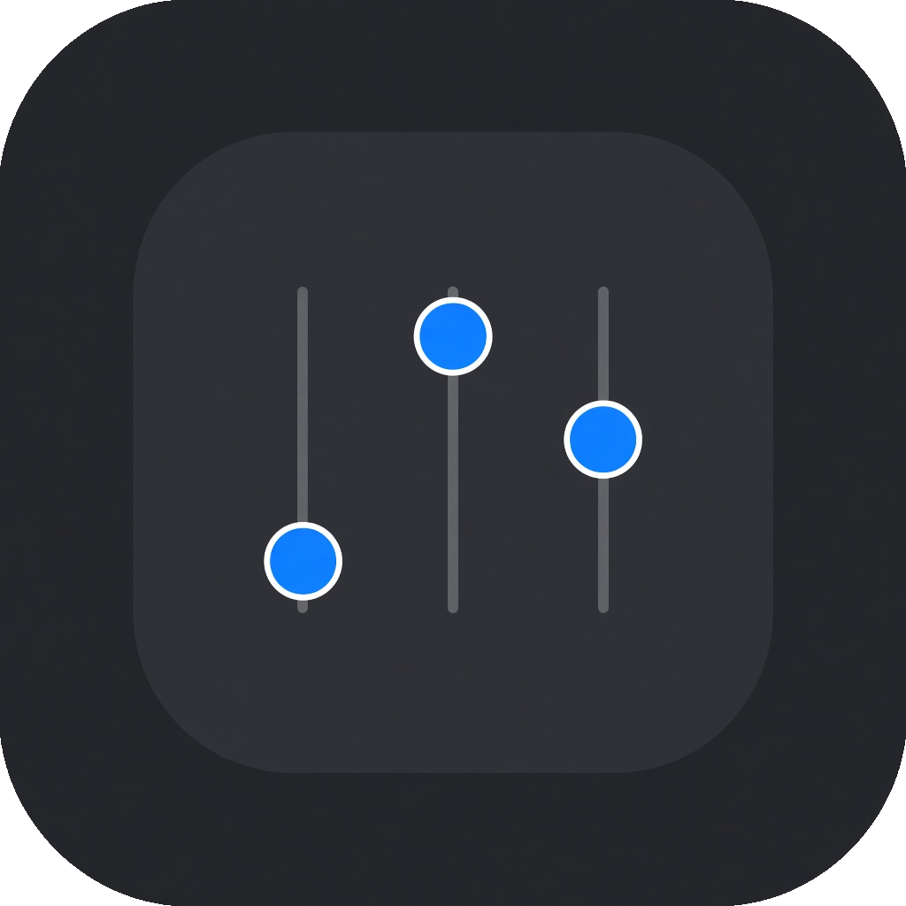
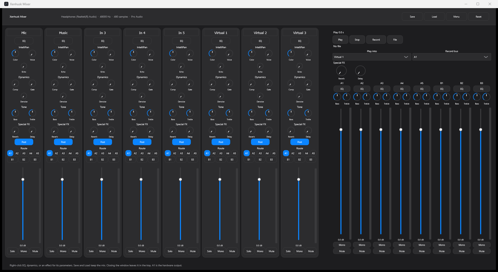
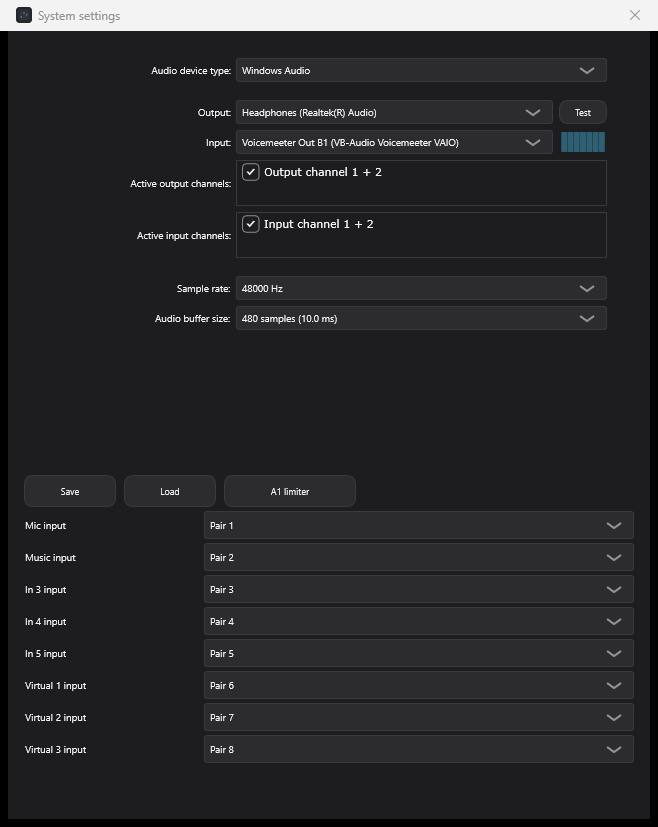

<p align="center">
  
</p>

<h1 align="center">Xenhusk Mixer</h1>

<p align="center">
  A Windows desktop mixer with eight strips, eight buses, and one hardware output.
</p>

The console is one screen. Each strip has tone, dynamics, sends, routing, a fader, and a meter. Closing the window leaves the mixer running in the tray.



## Mix

Eight strips start as Mic, Music, In 3, In 4, In 5, Virtual 1, Virtual 2, and Virtual 3. The names can be edited, and they are stored with the mix.

Each strip has:

- A 6-band EQ, plus Bass and Treble. The EQ is out of the signal until its button is on.
- Color, Voice, and Echo, with position and modulation behind a right-click.
- Comp, Gate, and Denoise. At zero, that block is bypassed.
- Reverb and Delay sends, switched Post or Pre.
- Routing to A1–A5 and B1–B3.
- A fader from −60 dB to +12 dB, a peak meter, and Solo, Mono, and Mute.

Any solo silences the strips that are not soloed. Mute silences the strip, including its sends.

## Buses

A1 is the hardware output. A2–A5 and B1–B3 stay in the mix: they have meters, faders, EQ, and they can be recorded. They do not appear as Windows playback devices.

Right-click a bus EQ for the same 6-band editor and that bus’s limiter. The limiter holds a peak above 0 dBFS at 0 dBFS.

## Right-click for the rest of the controls

| Right-click | What opens |
| --- | --- |
| EQ, Bass, or Treble | Six bands, a response curve, Flat, A/B memories, channel All / 1 / 2, Copy and Paste |
| Comp, Gate, or Denoise | Threshold, ratio, attack, release, and the rest of that block |
| Color, Voice, or Echo | Position, modulation, and the three knobs |
| Reverb or Delay | The shared effect: decay, pre-delay, early amount, wet return, and four delay taps |
| A bus EQ | The bus equalizer and its limiter |

Reverb presets are Room, Hall, Plate, and Chamber.

## System settings

Menu opens the device selector, the A1 limiter, and the input pair for each strip. Save and Load are there as well as on the top bar.



Save writes the current mix to XML. Load reads that file back. Load also accepts a VoiceMeeter settings export and maps strip names, faders, mute, solo, mono, bus assigns, EQ, compressor, gate, denoise, sends, and the shared reverb. It does not create virtual devices.

## Transport

Choose an audio file, then Play or Stop. Playback mixes into the strip selected next to Play into. Record writes the selected bus to a 16-bit stereo WAV file in `Documents\Xenhusk Mixer`.

## Tray

Closing the window hides it. The mixer keeps running.

- Left-click the tray icon to show the window.
- Right-click it for Restart Audio Engine, Show, Show at the default position, Hide, Shut Down, and Exit Menu.

Shut Down is what quits.

## Build

You need Windows, CMake 3.22 or newer, and Visual Studio 2022 with the C++ desktop tools. The first configure downloads JUCE 8.0.15.

```bat
cmake -S . -B build
cmake --build build --config Release
```

The app is `build\XenhuskMixer_artefacts\Release\Xenhusk Mixer.exe`.

With Ninja, from a Visual Studio developer prompt:

```bat
cmake -S . -B build -G Ninja -DCMAKE_BUILD_TYPE=Release
cmake --build build
```

## License

Xenhusk Mixer is released under the GNU Affero General Public License, version 3. The app is built with [JUCE](https://juce.com), which is available under the AGPL or a commercial license. See [LICENSE](LICENSE).
